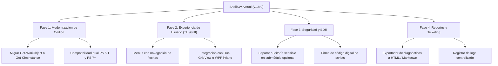

# Informe Comparativo y Plan de Mejoras: ShellSW

**Proyecto:** ShellSW (Administración y Gestión del Sistema Operativo)  
**Autor Original:** Ing. Wilson Yucra - spWil  
**Versión Evaluada:** 1.8.0  
**Fecha de Elaboración:** Octubre 2026  

---

## 1. Resumen Ejecutivo

**ShellSW** es un kit de herramientas para administración de sistemas y Helpdesk desarrollado con una arquitectura híbrida (*polyglot* Batch + PowerShell). Su valor diferencial radica en unificar en un único archivo ejecutable portable capacidades que normalmente se encuentran dispersas en varias herramientas:
1. Mantenimiento y optimización de hardware/software local.
2. Preparación de bajo nivel de discos y medios de arranque USB (integrando Ventoy, particionado MBR/GPT).
3. Administración remota de clientes (WMI, RPC, WinRM, capturas y diagnósticos).
4. Gestión de infraestructura corporativa bajo Active Directory (AD).

Este informe analiza herramientas homólogas en la industria de TI, evalúa ventajas y desventajas competitivas de ShellSW y propone una hoja de ruta técnica para llevar el proyecto a un nivel profesional y escalable.

---

## 2. Estudio de Herramientas Similares en la Industria

En el ecosistema de administración de Windows y soporte técnico existen diversas soluciones de código abierto y comunitarias. Ninguna cubre exactamente el mismo espectro de ShellSW, pero compiten directamente en áreas clave:

| Herramienta | Enfoque Principal | Tipo de Interfaz | Fortalezas | Brecha respecto a ShellSW |
| :--- | :--- | :--- | :--- | :--- |
| **Chris Titus Tech (CTT) WinUtil** | Optimización, desinstalación de *bloatware*, instalación masiva de programas (`winget`) y ajustes de rendimiento. | GUI interactiva en PowerShell (WPF / WinForms). | Interfaz visual moderna, mantenimiento muy activo, ejecución directa vía web (`irm christitus.com/win \| iex`). | No cuenta con herramientas para Active Directory, preparación avanzada de USB/discos, ni soporte de administración remota. |
| **Tron Script** | Desinfección extrema contra malware, reparación profunda y mantenimiento no interactivo. | Script Batch por consola (automatizado y desatendido). | Extremadamente exhaustivo para equipos comprometidos; integra antivirus de terceros de forma autónoma. | Es un proceso ciego que toma varias horas, carece de interactividad modular, no gestiona dominios ni redes remotas. |
| **Windows Repair Toolbox (WRT)** | Hub de diagnósticos para técnicos de taller y soporte en sitio. | GUI portable (.NET / WinForms). | Descarga y centraliza herramientas de terceros (Sysinternals, malware removal, pruebas de estrés). | Depende de conexión a internet para descargar binarios externos; no incluye gestión de AD ni administración remota de red. |
| **Sophia Script for Windows** | Debloating, personalización y configuración de privacidad en Windows 10/11. | Módulo nativo de PowerShell + Wrapper GUI. | Altamente modular, código limpio que cumple los estándares de PowerShell Gallery, compatible con CI/CD. | Se enfoca exclusivamente en *tweaks* y políticas del sistema operativo cliente; no realiza labores de Helpdesk o infraestructura. |
| **LazyWinAdmin / Community AD Toolkits** | Automatización de tareas de Active Directory y administración de servidores. | Consolas PowerShell y formularios WinForms sencillos. | Diseñado por y para administradores de sistemas en entornos corporativos. | Orientado exclusivamente a tareas de red y servidor; desatiende labores de soporte físico (discos, formateos, portátiles). |
| **RSAT (Microsoft) & Sysinternals Suite** | Herramientas oficiales estándar de la industria (PsExec, Process Explorer, MMC AD). | Consolas nativas MMC y utilidades CLI independientes. | Soporte oficial, estabilidad máxima y aceptación estándar en empresas. | Están fragmentadas en decenas de herramientas y consolas independientes sin un menú unificado rápido. |

---

## 3. Matriz de Ventajas, Desventajas y Beneficios de ShellSW

### 🟢 Ventajas (Fortalezas Técnicas)
* **Portabilidad Total ("Zero-Install"):** Gracias al diseño *polyglot* (`wrapper_template.bat` + `ShellSW.bat`), el script se ejecuta en cualquier equipo Windows con privilegios elevados con solo hacer doble clic, sin requerir instalaciones previas ni configuraciones de Python o dependencias externas.
* **Cobertura Híbrida Única:** Une dos mundos que suelen estar separados:
  1. *El soporte de taller/físico*: particionado de discos MBR/GPT, diagnóstico de baterías de laptops, preparación de USBs booteables con Ventoy.
  2. *El soporte corporativo*: comandos de Active Directory, auditoría remota por WMI/WinRM y control de servicios remotos.
* **Interoperabilidad Nativa Avanzada:** Uso de llamadas C# en memoria con P/Invoke (`[RamUtil]::EmptyWorkingSet`) para liberar memoria RAM en tiempo real sin requerir programas externos.
* **Arquitectura de Ensamblado Modular:** La estructura de la carpeta [src/](../src/) gobernada por [build.ps1](../build.ps1) permite desarrollar los módulos de forma limpia e independiente antes de empaquetar el producto final.
* **Auto-Reconstrucción en Desarrollo:** La función [psReconstruirSiDesarrollo](../src/helpers.ps1#L81-L105) detecta si el usuario está en el entorno del repositorio y recompila automáticamente los cambios.

### 🔴 Desventajas (Áreas de Riesgo y Deuda Técnica)
* **Navegación Numérica Rígida en Consola:** La interacción mediante números (1, 2... 28.1, etc.) es propensa a errores tipográficos y resulta menos amigable frente a interfaces modernas con selector de flechas (`Terminal.Gui`) o interfaces gráficas (`Out-GridView` / WPF).
* **Tamaño del Monolito Compilado:** Al concatenar todos los módulos, [ShellSW.bat](../ShellSW.bat) alcanza casi 1 MB de código fuente plano, lo que puede ralentizar la carga inicial de PowerShell y dificultar la depuración directa en producción.
* **Compatibilidad con PowerShell 7+ / WMI Legacy:** Gran parte de los submódulos de consulta (`subMenu20`, `subMenu23`, `subMenu25`) utilizan `Get-WmiObject`. Este cmdlet fue deprecado y removido en PowerShell Core (PS 7), el cual requiere el estándar moderno `Get-CimInstance`.
* **Riesgo con Soluciones Antivirus / EDR:** Módulos de auditoría de contraseñas y base de datos SQLite en navegadores ([helpers.ps1](../src/helpers.ps1) y `subMenu25`) pueden ser detectados como comportamiento de herramientas de ataque (post-explotación o robo de credenciales) por Windows Defender, bloqueando la herramienta en entornos corporativos protegidos.
* **Falta de Trazabilidad y Logging Estructurado:** La mayoría de salidas se imprimen en consola con `Write-Host`. No existe un registro unificado en archivo de log o formato JSON/CSV para adjuntar evidencias técnicas a tickets de soporte.

### 💎 Beneficios para el Administrador o Departamento de TI
1. **Reducción del MTTR (*Mean Time to Resolution*):** Disminuye de forma drástica el tiempo empleado en tareas rutinarias (forzar `gpupdate`, diagnosticar impresoras, resetear red, desbloquear usuarios).
2. **Estandarización Operativa:** Garantiza que los técnicos de nivel 1 y 2 ejecuten los mismos procedimientos de diagnóstico y formateo de forma consistente.
3. **Independencia de Internet:** A diferencia de instaladores que descargan binarios en tiempo de ejecución, el núcleo de ShellSW opera sin conexión a internet en redes aisladas o infraestructuras críticas.

---

## 4. Hoja de Ruta de Mejoras Sugeridas (Roadmap)



### 1. Modernización de Cmdlets (CIM vs. WMI)
- **Problema:** `Get-WmiObject` no funciona en PowerShell 7+.
- **Solución:** Reemplazar progresivamente las llamadas por `Get-CimInstance` con compatibilidad retroactiva a PowerShell 5.1.
- **Impacto:** Mayor velocidad en consultas remotas (CIM utiliza WinRM y WS-Man en lugar de DCOM/RPC clásico, atravesando firewalls con menor fricción).

### 2. Evolución de la Interfaz (TUI Interactiva)
- **Problema:** Escribir subopciones anidadas ("23.1", "29.2") genera fatiga operativa.
- **Solución:**
  - Implementar un selector de menú interactivo navegable mediante teclas de flechas (usando `[Console]::ReadKey()`).
  - Para selección de listas (como unidades de disco o usuarios de AD), integrar `Out-GridView -OutputMode Single` nativo de PowerShell, brindando una experiencia híbrida visual sin romper la portabilidad.

### 3. Sistema de Registro de Auditoría y Reportes (Helpdesk Evidence)
- **Propuesta:** Crear una función centralizada `Write-LogReport` que genere un informe en formato Markdown o HTML embebido en la carpeta `C:\Temp\ShellSW_Logs\`.
- **Utilidad:** Cada vez que el técnico revise un equipo, revise el estado de la batería o audite una cuenta, podrá exportar un archivo formal listo para anexar al ticket en Jira, GLPI u osTicket.

### 4. Integración con el Gestor de Paquetes de Windows (`winget`)
- **Propuesta:** Añadir en un nuevo submódulo una lista curada de software técnico estándar para desplegar en equipos nuevos (Navegadores, 7-Zip, AnyDesk/TeamViewer, Acrobat Reader, VS Code) usando comandos nativos:
  ```powershell
  winget install --id 7zip.7zip -e --silent --accept-source-agreements
  ```
- Esto pondría a ShellSW a la par de las mejores funcionalidades de instalador desatendido de *WinUtil*.

### 5. Arquitectura Modular con Ejecución Directa por Línea de Comandos (CLI Flags)
- **Propuesta:** Permitir que las funciones de ShellSW se puedan invocar tanto interactivamente como por parámetros de consola:
  ```powershell
  .\ShellSW.bat -Module RAM -Optimizar
  .\ShellSW.bat -Module AD -UnlockUser "juan.perez"
  ```
- **Beneficio:** Abre la puerta a la automatización mediante tareas programadas de Windows o plataformas de administración centralizada (RMM/Ansible).

### 6. Desacoplamiento de Módulos Sensibles de Seguridad
- **Recomendación:** Trasladar la extracción de credenciales de navegadores de [subMenu25.ps1](../src/subMenu25.ps1) y [helpers.ps1](../src/helpers.ps1) a un paquete o extensión separada (`recursosExtras/`). Esto evita que motores antivirus empresariales marquen el binario principal `ShellSW.bat` como falso positivo malicioso (HackTool o PasswordStealer).
