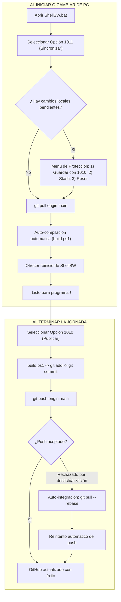

# Manual de Trabajo Multi-PC y Sincronización Git: Opciones 1010 y 1011

Este documento detalla el funcionamiento, arquitectura y mejores prácticas para desarrollar el proyecto **`shellWil`** alternando entre dos o más computadoras sin sufrir bloqueos, rechazos de versión (*non-fast-forward*) o pérdida de código.

---

## 1. Análisis del Problema: ¿Por qué ocurren rechazos en Git entre 2 PCs?

Al alternar el desarrollo entre dos equipos (por ejemplo, **PC 1 en oficina/casa** y **PC 2 laptop/portátil**), el repositorio remoto en GitHub actúa como el punto único de verdad. Los problemas habituales surgen por las siguientes causas:

1. **Rechazo por Desfase de Historial (*Non-Fast-Forward / Fetch First*):**
   Si en la **PC 1** modificas archivos, haces commit y subes a GitHub (`push`), el historial de GitHub avanza. Si luego abres la **PC 2**, haces cambios locales y ejecutas `git push` sin haber bajado antes lo de la PC 1, GitHub **rechaza la subida** porque tu PC 2 desconoce los cambios previos.
2. **Archivos de Bloqueo (`*.lock`):**
   Si la carpeta del proyecto está en un entorno sincronizado por la nube (como Google Drive) o un proceso previo de PowerShell/Git se interrumpió abruptamente, quedan archivos residuales como `.git/index.lock`, impidiendo cualquier operación de Git.
3. **Desincronización de Compilación (`ShellSW.bat`):**
   Si solo bajas los cambios con `git pull` pero no ejecutas `build.ps1`, el archivo monolítico ejecutable `ShellSW.bat` queda con la versión antigua, generando discrepancias entre los módulos en `src/` y el script ejecutable.
4. **Pérdida de Cambios no Guardados al intentar hacer `pull`:**
   Si tienes archivos modificados en la PC actual y ejecutas un `git pull` directo, Git cancela la operación para no sobrescribir tus cambios locales (`error: Your local changes to the following files would be overwritten by merge`).

---

## 2. Arquitectura de las Soluciones Implementadas

Para resolver estos escenarios de forma 100% automatizada e integrada en la propia herramienta, se implementaron dos funciones centrales en [helpers.ps1](../src/helpers.ps1) y se vincularon al menú en [menuPrincipal.ps1](../src/menuPrincipal.ps1):



---

## 3. Detalle de la Opción 1011: Continuar y Sincronizar Proyecto

La **Opción 1011** (`Invoke-GitSincronizar1011`) fue concebida para ser ejecutada **al sentarse en cualquier PC después de una pausa o cambio de equipo**.

### Flujo de Ejecución Automatizado:
1. **Detección de Entorno y Directorio Seguro:**
   - Detecta la raíz del repositorio de forma dinámica mediante `Get-ShellWorkspacePath`.
   - Normaliza y registra automáticamente `safe.directory` en Git para evitar advertencias de seguridad al trabajar como Administrador o sobre unidades de red.
2. **Limpieza Automática de Bloqueos (`*.lock`):**
   - Escanea el directorio `.git` en busca de archivos `.lock` generados por Google Drive o caídas previas y ofrece eliminarlos con un solo clic.
3. **Protección de Cambios Locales Pendientes:**
   - Si detecta que dejaste archivos modificados en la PC actual, no permite que se pierdan ni se produzca un error de Git. Te presenta 4 opciones claras:
     - **Opción 1 [Recomendada]:** Reutiliza la **Opción 1010** para empaquetar, guardar y subir primero tus cambios locales a GitHub.
     - **Opción 2 (Stash):** Guarda tus cambios en un casillero temporal (`git stash`), descarga los cambios remotos y re-aplica tus modificaciones locales encima.
     - **Opción 3 (Reset):** Descarta las modificaciones locales si solo fueron pruebas descartables y pone tu equipo al día con GitHub.
     - **Opción 4:** Cancela para que revises con calma.
4. **Descarga de Cambios (`git pull origin <rama>`):**
   - Detecta la rama activa actual (por defecto `main`).
   - Ejecuta la descarga y muestra un reporte legible con los últimos commits incorporados.
5. **Reconstrucción Automática del Binario (`build.ps1`):**
   - Ejecuta `psReconstruirSiDesarrollo` de manera que `ShellSW.bat` queda ensamblado y actualizado de inmediato con los cambios recién bajados.
6. **Recarga en Caliente:**
   - Pregunta al desarrollador si desea reiniciar `ShellSW` en ese mismo instante para cargar la nueva lógica en memoria.

---

## 4. Detalle de la Opción 1010 Mejorada: Guardar y Publicar en GitHub

La **Opción 1010** (`Invoke-GitPublicar1010`) fue repotenciada con un mecanismo de **reintento y auto-rebase inteligente**:

### Mejoras Incorporadas:
1. **Ensamblado previo:** Ejecuta `build.ps1` para asegurar que ningún cambio en `src/` quede fuera de `ShellSW.bat`.
2. **Commit interactivo:** Muestra `git status -s` detallado y solicita un mensaje claro para el commit.
3. **Detección de Rechazo (*Anti Non-Fast-Forward*):**
   - Si la otra computadora subió cambios previamente y olvidaste usar la Opción 1011 al iniciar, el `git push` original fallará.
   - En lugar de abortar con un error incomprensible de Git, la Opción 1010 detecta el mensaje `[rejected]` o `fetch first` y pregunta:
     > *"GitHub rechazó la subida: La otra PC subió cambios que aún no tienes en este equipo. ¿Deseas descargar e integrar los cambios de GitHub (git pull --rebase) y reintentar la subida? (S/N) [S]"*
   - Al confirmar, ejecuta `git pull --rebase origin main`, integra los commits y **reintenta la subida automáticamente**. ¡Cero bloqueos!

---

## 5. Tabla de Referencia Rápida para el Desarrollador

> [!NOTE]
> **Modo Oculto por Seguridad:** Las opciones **`1010`** y **`1011`** no se muestran en el listado visual del menú para evitar que operadores finales o terceros las ejecuten accidentalmente. Están siempre activas: basta con escribir `1010` o `1011` en la consola y presionar Enter.

| Momento | Acción a Realizar | ¿Qué hace internamente? |
| :--- | :--- | :--- |
| **Al sentarte en la PC 1 o PC 2** | Escribir **`1011`** en el menú de ShellSW | Limpia locks + revisa cambios pendientes + hace `git pull origin main` + auto-compila con `build.ps1` + ofrece reiniciar. |
| **Al terminar de programar** | Escribir **`1010`** en el menú de ShellSW | Auto-compila + `git add -A` + `git commit -m "..."` + `git push origin main` (con auto-resolución si hay cambios remotos). |

---

## 6. Configuración de Credenciales en una Nueva PC

Para que tanto la Opción 1010 como la 1011 puedan comunicarse con GitHub sin pedir contraseña repetidamente en la segunda computadora, basta con ejecutar este comando una única vez en la consola de Windows:

```powershell
git config --global credential.helper manager
```

La primera vez que hagas `push` o `pull`, Windows abrirá una ventana del navegador solicitando autorizar tu cuenta de GitHub (`spwil`). Una vez autorizado, el Administrador de Credenciales de Windows recordará la sesión de forma segura y permanente.
